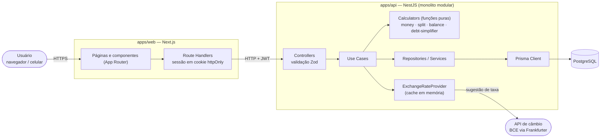
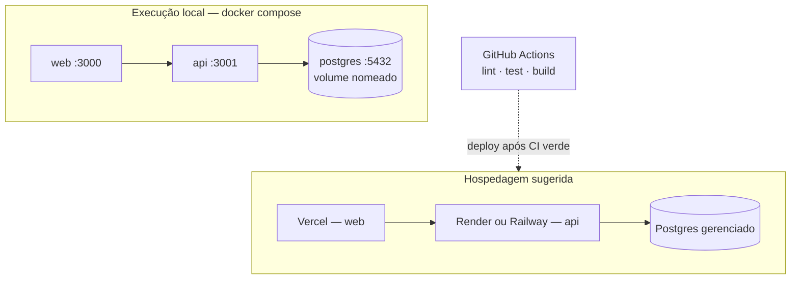

# Split&Go

Gestão e rateio inteligente de despesas em grupo. Lance os gastos de uma viagem, de uma república ou de um evento, divida cada um como quiser e receba o **menor número possível de transferências** para zerar todas as dívidas.

> **Estado do projeto:** especificação, arquitetura, backlog e automação de desenvolvimento concluídos. A implementação avança task a task pelo board **Split and Go Case** (ver [Gestão do projeto](#gestão-do-projeto)). As seções "Como rodar" descrevem o comportamento que as tasks #1 a #5 entregam.

## Sumário

- [O que o produto faz](#o-que-o-produto-faz)
- [Arquitetura](#arquitetura)
- [Stack e justificativas](#stack-e-justificativas)
- [Como rodar localmente](#como-rodar-localmente)
- [Algoritmo de simplificação de saldo](#algoritmo-de-simplificação-de-saldo)
- [Edge cases](#edge-cases)
- [Evolução do produto (V2)](#evolução-do-produto-v2)
- [Gestão do projeto](#gestão-do-projeto)
- [Documentação](#documentação)

## O que o produto faz

1. **Grupos e participantes:** crie um grupo com vários participantes (com ou sem conta).
2. **Despesas flexíveis:** uma pessoa paga, N pessoas dividem. Rateio **igualitário** (ex.: R$ 100 / 4), por **porcentagem** ou por **valor fixo**.
3. **Moedas diferentes:** cada grupo tem uma moeda-base; cada despesa pode ser lançada em outra moeda, com a taxa sugerida automaticamente (e editável) e registrada na despesa.
4. **Simplificação de saldo:** o sistema calcula quem deve a quem e minimiza as transferências. Se A deve 50 a B e B deve 50 a C, o plano sugere que A pague 50 direto a C.
5. **Painel de quitação:** extrato individual de cada participante e plano final de liquidação, com fechamento do grupo e acompanhamento dos pagamentos.

Escopo do MVP: **multi-moeda** (moeda-base por grupo, despesas em 10 moedas com taxa de câmbio registrada) e login por e-mail e senha. Ver [`docs/specs/00-product-overview.md`](docs/specs/00-product-overview.md).

## Arquitetura

### Visão da aplicação



### Infraestrutura



### Estilo arquitetural

**Monolito modular em camadas tradicionais, separado por domínio, sem DDD:**

```
Controller  →  Use Case  →  Repository / Service
 (HTTP/Zod)    (orquestra)    (dados / integrações)
```

- Módulos: `auth`, `users`, `groups`, `currencies`, `exchange-rates`, `expenses`, `balances`, `settlements`.
- As regras complexas (rateio com resto de centavos, saldo e simplificação de dívidas) ficam em **funções puras e testáveis** (`*.calculator.ts`, `debt-simplifier.ts`), sem acesso a banco. Os use cases apenas orquestram.
- Interfaces só quando há necessidade real; hoje apenas `ExchangeRateProvider` (fronteira externa do câmbio, com implementação falsa nos testes).
- Dinheiro sempre em **inteiros na menor unidade da moeda** (centavos em BRL, ienes em JPY); porcentagem em **basis points**; taxa de câmbio em texto decimal convertido com `BigInt`. Nunca ponto flutuante.

Detalhes: [`docs/architecture/plan.md`](docs/architecture/plan.md), [`data-model.md`](docs/architecture/data-model.md), [`api-contract.md`](docs/architecture/api-contract.md) e os [ADRs](docs/architecture/decisions/).

## Stack e justificativas

| Camada | Tecnologia | Por quê |
|---|---|---|
| Back-end | **NestJS** (LTS) + TypeScript | Módulos nativos que mapeiam o monolito modular por domínio; injeção de dependência; ecossistema maduro. |
| Validação | **Zod** | Valida a entrada nos controllers e gera os tipos TypeScript. |
| ORM | **Prisma** | Schema declarativo, migrations versionadas, client tipado. |
| Banco | **PostgreSQL** | Dados relacionais, transações ACID para fechamento de grupo e integridade dos saldos. |
| Front-end | **Next.js** (App Router) + Tailwind | SSR, Route Handlers para guardar o JWT em cookie `httpOnly`, mesma linguagem do back-end. |
| Qualidade | **ESLint + Prettier**, Vitest/Jest, Playwright | Padronização e testes em todos os níveis. |
| Infra local | **Docker Compose** | Um comando sobe banco, API e web. |
| CI | **GitHub Actions** | Lint, typecheck, testes e build a cada PR. |
| Câmbio | Frankfurter (taxas do BCE) | Sugestão gratuita de taxa por data; o usuário confirma ou edita (ADR 0006). |
| Fila / cache | Sem fila; cache em memória só para taxas | Os cálculos levam milissegundos (ADR 0005). |

## Como rodar localmente

Requisitos: Docker e Docker Compose. Para desenvolvimento sem Docker: Node.js (LTS) e pnpm.

### Com Docker Compose

```bash
cp .env.example .env
docker compose up --build
```

| Serviço | URL |
|---|---|
| Aplicação (web) | http://localhost:3000 |
| API | http://localhost:3001 (`GET /health`) |
| PostgreSQL | `localhost:5432` |

As migrations são aplicadas automaticamente na subida da API.

### Sem Docker (desenvolvimento)

```bash
pnpm install
cp apps/api/.env.example apps/api/.env      # ajuste DATABASE_URL e JWT_SECRET
cp apps/web/.env.example apps/web/.env
docker compose up -d postgres               # apenas o banco
pnpm --filter api prisma migrate dev        # migrations + seed
pnpm dev                                    # api :3001 e web :3000
```

### Qualidade

```bash
pnpm lint && pnpm typecheck && pnpm test && pnpm build
```

## Algoritmo de simplificação de saldo

1. **Saldo de cada pessoa** = total que pagou − total que deve (soma sempre `0`).
2. Minimizar transferências equivale a **dividir o grupo no maior número de subgrupos cuja soma de saldos é zero**: cada subgrupo de `k` pessoas se resolve com `k − 1` transferências.
3. Até 16 saldos diferentes de zero, o resultado é **exato** (programação dinâmica por bitmask). Acima disso, uma heurística gulosa garante no máximo `n − 1` transferências.
4. O resultado é determinístico.

Exemplo: saldos `A=+5, B=−3, C=−2, D=+4, E=−4` geram **3** transferências (`B→A 3`, `C→A 2`, `E→D 4`); a abordagem gulosa pura geraria 4. Detalhes no [ADR 0002](docs/architecture/decisions/0002-debt-simplification.md).

## Edge cases

Os principais cenários de borda e como são tratados (lista completa em [`docs/engineering/edge-cases.md`](docs/engineering/edge-cases.md)):

| Cenário | Tratamento |
|---|---|
| **Resto de centavos** (R$ 100 / 3) | Divisão em centavos inteiros; o resto é distribuído 1 centavo por vez em ordem determinística: 33,34 · 33,33 · 33,33. A soma é sempre o total. |
| **Porcentagens ou valores fixos que não fecham** | Rejeitados com `422` (`SPLIT_PERCENTAGE_SUM_INVALID`, `SPLIT_FIXED_SUM_INVALID`); a interface mostra quanto falta. |
| **Pagador fora do rateio** | Permitido. O saldo é `pago − devido`, então ele fica com o crédito integral. |
| **Moedas diferentes** (US$ 100 em grupo BRL) | A despesa guarda moeda, valor original, taxa e valor convertido (snapshot imutável, em `BigInt`, meio para cima). O rateio é feito nas duas moedas com a mesma regra de maior resto, então as somas fecham exato. A taxa é sugerida pelo BCE e editável; se o provedor cair, o usuário informa a taxa. |
| **Moedas sem casas decimais** (JPY, KRW) | O catálogo de moedas define as casas decimais; os valores são inteiros na menor unidade (¥ 5.000 = `5000`) e a interface não aceita decimais nelas. |
| **Dívidas circulares** | O plano parte do saldo líquido, então o ciclo A→B→C→A se anula e o plano é vazio. |
| **Fechamento concorrente** | Fechar o grupo e lançar despesa travam a linha do grupo na transação: uma despesa entra no plano ou é rejeitada. |

## Evolução do produto (V2)

**Melhorias de negócio**

1. **Liquidação em múltiplas moedas e câmbio no dia do pagamento:** o plano passa a respeitar a moeda em que cada pessoa prefere pagar, reduzindo perdas de câmbio.
2. **Convites por link e notificações:** aumenta ativação e retenção com loop viral e acelera a quitação com lembretes.
3. **Pagamento integrado (Pix) e conciliação:** fecha o ciclo do produto e abre uma linha de receita.

**Novas funcionalidades**

- **Recibos com OCR:** reduz o esforço de lançamento, principal causa de abandono em apps de rateio.
- **Despesas recorrentes e categorias com relatórios:** leva o uso de viagens (esporádico) para repúblicas e casais (mensal), aumentando retenção e receita recorrente.

Impacto detalhado em [`docs/engineering/roadmap-v2.md`](docs/engineering/roadmap-v2.md).

## Gestão do projeto

O trabalho é planejado e acompanhado no **GitHub Projects — Split and Go Case**, com as colunas:

`Backlog → In Progress → In Review/Testing → Done`

- Cada task tem história de usuário e critérios de aceite ([`docs/tasks/backlog.md`](docs/tasks/backlog.md)).
- **Commits semânticos** (Conventional Commits) ligados às issues (`Refs #n`); PRs com `Closes #n` e merge por squash ([`docs/engineering/git-workflow.md`](docs/engineering/git-workflow.md)).
- **Desenvolvimento assistido por IA com revisão obrigatória:** três agentes (back-end, front-end e revisor de código) e o fluxo `/run-task <issue>` levam a task de Backlog até Done, com revisão contra os critérios de aceite ([`docs/ai/`](docs/ai/)).

## Documentação

| Pasta | Conteúdo |
|---|---|
| [`docs/constitution.md`](docs/constitution.md) | Princípios inegociáveis |
| [`docs/specs/`](docs/specs/) | Especificações: visão, auth, grupos, despesas, saldos, painel |
| [`docs/architecture/`](docs/architecture/) | Plano, modelo de dados, contrato da API, ADRs |
| [`docs/engineering/`](docs/engineering/) | Padrões de código, git, testes, edge cases, roadmap V2 |
| [`docs/tasks/`](docs/tasks/) | Backlog (espelhado no board) |
| [`docs/ai/`](docs/ai/) | Agentes, fluxo automatizado e configuração do board |
