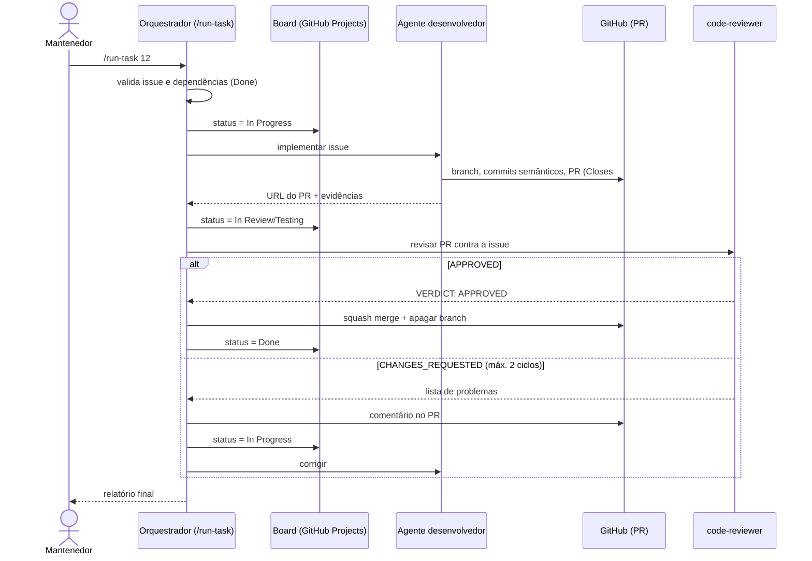

# Fluxo Automatizado de Desenvolvimento

Uma única instrução leva uma issue do **Backlog** até **Done**:

```
/run-task <número-da-issue>
```

A skill `.claude/skills/run-task/SKILL.md` orquestra o fluxo. O estado de cada tarefa é sempre visível no board **Split and Go Case**.

## Diagrama



## Estados do card

| Status | Entra quando | Sai quando |
|---|---|---|
| **Backlog** | A issue é criada a partir de `docs/tasks/backlog.md` | O mantenedor executa `/run-task` |
| **In Progress** | O orquestrador inicia a tarefa (ou o revisor pede mudanças) | O agente desenvolvedor abre o PR |
| **In Review/Testing** | PR aberto | O revisor emite o veredito |
| **Done** | Veredito `APPROVED`, CI verde e PR mergeado | — |

## Passo a passo

1. **Especificação da tarefa.** O mantenedor escolhe a issue (já com critérios de aceite) e roda `/run-task <n>`.
2. **Pré-condições.** O orquestrador confirma que a issue está em Backlog, que as dependências (`Depende de`) estão em Done e que a árvore de trabalho está limpa.
3. **In Progress.** `scripts/board/board.sh set-status <n> "In Progress"`.
4. **Desenvolvimento.** O agente certo (por label) lê a issue e a documentação, cria a branch `<tipo>/<n>-<slug>` (a partir do campo `Título do PR` da issue), implementa, escreve testes, roda lint/typecheck/testes/build e abre o PR com `Closes #<n>`.
5. **In Review/Testing.** O orquestrador move o card.
6. **Revisão.** O `code-reviewer` executa as verificações e confere cada critério de aceite com evidência.
7. **Resultado.**
   - `APPROVED`: se o CI estiver verde, squash merge, atualização da `main` local e card em **Done**.
   - `CHANGES_REQUESTED`: comentário no PR, card volta para **In Progress**, o desenvolvedor corrige e o ciclo recomeça (máximo 2).
8. **Relatório.** Links, status final, ciclos de revisão e sugestões de novas tasks.

## Rastreabilidade

Cada artefato aponta para a issue, e a issue aponta para a spec:

```
Spec (docs/specs) ──► Task (docs/tasks/backlog.md) ──► Issue #n ──► Branch <tipo>/<n>-slug
                                                                   └► Commits "… Refs #n"
                                                                   └► PR "Closes #n" ──► Done
```

## Como parar ou retomar

- O fluxo para sozinho em qualquer erro inesperado, dúvida de spec, falha de CI não corrigida ou segunda reprovação, deixando o card em **In Progress**.
- Para retomar, rode `/run-task <n>` novamente: a skill aceita issues em `In Progress` e reaproveita a branch existente.
- Ajuste manual do board: `scripts/board/board.sh set-status <n> "<status>"`.

## Premissas

- O merge após aprovação é feito pelo orquestrador (squash), porque a conta autora do PR não pode aprovar o próprio PR no GitHub. A aprovação do revisor fica registrada no comentário e no relatório.
- Quando o repositório tiver CI (task #6), o merge só acontece com checks verdes.
