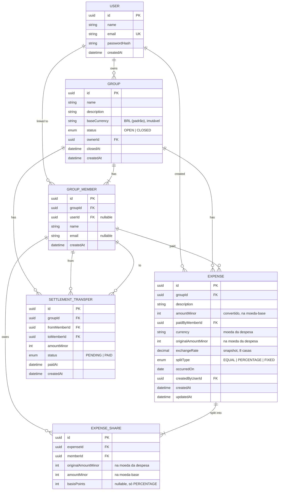

# Modelo de Dados

Banco: PostgreSQL. ORM: Prisma. Todo dinheiro em **inteiros na menor unidade da moeda** (`...Minor`); porcentagem em **basis points**; taxa de câmbio em `Decimal(18,8)`.

## ERD



## Rascunho do schema Prisma

> O schema definitivo nasce na task de Prisma (#4). Este rascunho fixa nomes, tipos e constraints.

```prisma
generator client {
  provider = "prisma-client-js"
}

datasource db {
  provider = "postgresql"
  url      = env("DATABASE_URL")
}

enum GroupStatus {
  OPEN
  CLOSED
}

enum SplitType {
  EQUAL
  PERCENTAGE
  FIXED
}

enum TransferStatus {
  PENDING
  PAID
}

model User {
  id           String   @id @default(uuid()) @db.Uuid
  name         String
  email        String   @unique
  passwordHash String
  createdAt    DateTime @default(now())

  ownedGroups Group[]
  memberships GroupMember[]
  expenses    Expense[]
}

model Group {
  id          String      @id @default(uuid()) @db.Uuid
  name        String
  description String?
  baseCurrency String     @default("BRL") // moeda-base, imutável
  status      GroupStatus @default(OPEN)
  ownerId     String      @db.Uuid
  closedAt    DateTime?
  createdAt   DateTime    @default(now())

  owner     User                 @relation(fields: [ownerId], references: [id])
  members   GroupMember[]
  expenses  Expense[]
  transfers SettlementTransfer[]

  @@index([ownerId])
}

model GroupMember {
  id        String   @id @default(uuid()) @db.Uuid
  groupId   String   @db.Uuid
  userId    String?  @db.Uuid
  name      String
  email     String?
  createdAt DateTime @default(now())

  group Group @relation(fields: [groupId], references: [id], onDelete: Cascade)
  user  User? @relation(fields: [userId], references: [id])

  paidExpenses  Expense[]
  shares        ExpenseShare[]
  transfersFrom SettlementTransfer[] @relation("TransferFrom")
  transfersTo   SettlementTransfer[] @relation("TransferTo")

  @@unique([groupId, userId])
  @@unique([groupId, email])
  @@index([userId])
  @@index([email])
  // Unicidade case-insensitive de nome: índice único em lower(name) criado via SQL na migration.
}

model Expense {
  id              String    @id @default(uuid()) @db.Uuid
  groupId         String    @db.Uuid
  description     String
  currency            String   // moeda da despesa (catálogo em common/money)
  originalAmountMinor Int      // na menor unidade de `currency`
  exchangeRate        Decimal  @db.Decimal(18, 8) // 1 unidade de `currency` em moeda-base; snapshot
  amountMinor         Int      // convertido, na moeda-base
  paidByMemberId  String    @db.Uuid
  splitType       SplitType
  occurredOn      DateTime  @db.Date
  createdByUserId String    @db.Uuid
  createdAt       DateTime  @default(now())
  updatedAt       DateTime  @updatedAt

  group     Group          @relation(fields: [groupId], references: [id], onDelete: Cascade)
  paidBy    GroupMember    @relation(fields: [paidByMemberId], references: [id])
  createdBy User           @relation(fields: [createdByUserId], references: [id])
  shares    ExpenseShare[]

  @@index([groupId, occurredOn(sort: Desc), createdAt(sort: Desc)])
  // CHECK (amount_minor > 0) via SQL na migration.
}

model ExpenseShare {
  id          String @id @default(uuid()) @db.Uuid
  expenseId   String @db.Uuid
  memberId    String @db.Uuid
  originalAmountMinor Int // parte na moeda da despesa
  amountMinor         Int // parte na moeda-base (entra no saldo)
  basisPoints Int?

  expense Expense     @relation(fields: [expenseId], references: [id], onDelete: Cascade)
  member  GroupMember @relation(fields: [memberId], references: [id])

  @@unique([expenseId, memberId])
  @@index([memberId])
  // CHECK (amount_minor >= 0) via SQL na migration.
}

model SettlementTransfer {
  id           String         @id @default(uuid()) @db.Uuid
  groupId      String         @db.Uuid
  fromMemberId String         @db.Uuid
  toMemberId   String         @db.Uuid
  amountMinor  Int
  status       TransferStatus @default(PENDING)
  paidAt       DateTime?
  createdAt    DateTime       @default(now())

  group  Group       @relation(fields: [groupId], references: [id], onDelete: Cascade)
  from   GroupMember @relation("TransferFrom", fields: [fromMemberId], references: [id])
  to     GroupMember @relation("TransferTo", fields: [toMemberId], references: [id])

  @@unique([groupId, fromMemberId, toMemberId])
  @@index([groupId])
  // CHECK (amount_minor > 0 AND from_member_id <> to_member_id) via SQL na migration.
}
```

## Constraints e invariantes

| Regra | Onde é garantida |
|---|---|
| E-mail único por usuário | `@unique` (e normalização na aplicação) |
| E-mail e usuário únicos por grupo | `@@unique([groupId, email])`, `@@unique([groupId, userId])` |
| Nome único por grupo (sem diferenciar maiúsculas) | Índice único em `lower(name)` por grupo, criado por SQL na migration |
| `originalAmountMinor > 0`, `amountMinor > 0` e `exchangeRate > 0` na despesa | `CHECK` na migration + validação Zod |
| Soma das partes originais = `originalAmountMinor` e das convertidas = `amountMinor` | Calculator + conferência no use case antes de persistir |
| `currency = baseCurrency` implica `exchangeRate = 1` | Use case (RN-CUR-03) |
| Uma parte por participante por despesa | `@@unique([expenseId, memberId])` |
| Soma das partes = valor da despesa | Calculator + conferência no use case antes de persistir |
| Soma dos saldos = 0 | Garantida pelos dois itens acima; verificada em runtime em `balances` |
| Transferência `from ≠ to` e `> 0` | `CHECK` na migration |
| Não editar grupo `CLOSED` | Use cases (com lock da linha do grupo) |

## Notas de modelagem

- Valores em `Int` (32 bits, máximo ≈ 2,1 bilhões de unidades mínimas). O limite de negócio por despesa é `1.000.000.000`, abaixo disso. Somas de saldo usam `number` no código (seguro até 2⁵³). A conversão cambial usa `BigInt`.
- `exchangeRate` é `Decimal(18,8)`; no código trafega como texto decimal e nunca como `number`.
- O snapshot da despesa (moeda, valor original, taxa, valor convertido) não é recalculado: mudar a taxa de mercado não altera o histórico.
- As partes são **persistidas** (e não recalculadas a cada consulta) para que o histórico não mude se a regra de arredondamento evoluir.
- A remoção de participante é física e bloqueada quando há despesas (`RN-GRP-07`), então não existe estado "órfão".
- Exclusão de despesa é física no MVP; trilha de auditoria é item de roadmap.
