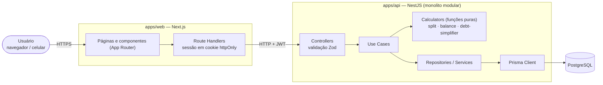
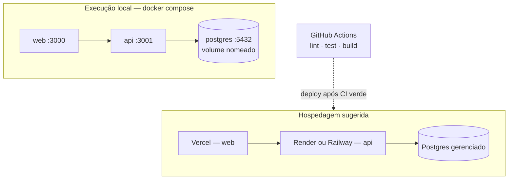
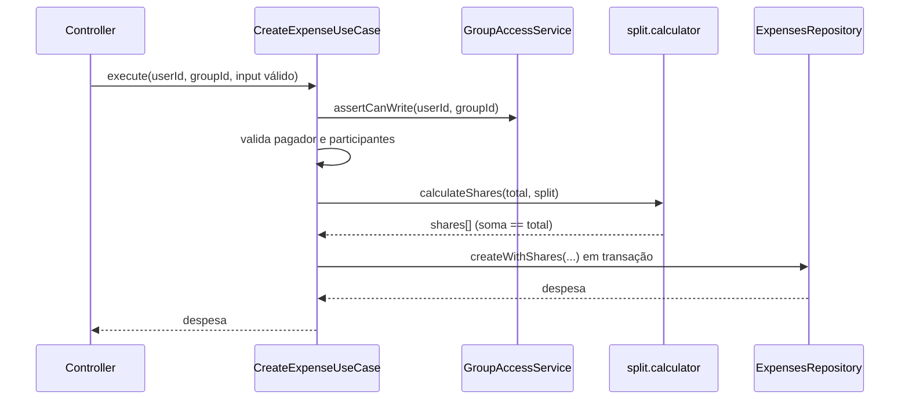

# Plano de Arquitetura

Este documento descreve **como** o Split&Go é construído. O **quê** está em `docs/specs/`. Princípios inegociáveis estão em `docs/constitution.md`.

## 1. Visão geral



### Infraestrutura



| Componente | Escolha | Por quê |
|---|---|---|
| Banco | PostgreSQL | Dados altamente relacionais (grupo → participantes → despesas → partes), transações ACID para fechamento e invariantes de saldo, tipos inteiros exatos. |
| API | NestJS (LTS) + TypeScript | Estrutura modular nativa que mapeia direto para o monolito modular por domínio; injeção de dependência; ecossistema maduro. |
| ORM | Prisma | Schema declarativo, migrations versionadas, client tipado. |
| Validação | Zod | Schemas viram tipos TypeScript; compartilhável entre API e web. |
| Front-end | Next.js (App Router) | SSR, route handlers para guardar o JWT em cookie `httpOnly`, mesmo ecossistema TypeScript. |
| Fila / cache | **Não utilizados no MVP** | Cálculos são O(2ⁿ·n) com n ≤ 16 e rodam em milissegundos. Ver ADR 0005. |
| Local | Docker Compose | Um comando sobe banco, API e web. |
| CI | GitHub Actions | Lint, testes e build a cada PR. |

## 2. Estilo arquitetural

**Monolito modular, em camadas tradicionais, separado por domínio.** Sem DDD.

```
Controller  →  Use Case  →  Repository / Service
 (HTTP/Zod)    (orquestra)    (dados / integrações)
```

| Camada | Responsabilidade | Não faz |
|---|---|---|
| **Controller** | Rotas, autenticação (guard), parse e validação Zod, chamar um use case, formatar resposta. | Regra de negócio, acesso a banco. |
| **Use Case** | Um caso de uso = uma classe com `execute()`. Autorização por grupo, carregar dados, chamar calculators, persistir (em transação quando preciso). | Conhecer HTTP. |
| **Repository** | Consultas Prisma de um módulo. Retorna tipos do Prisma ou DTOs simples. | Regra de negócio. |
| **Service** | Lógica reutilizável entre use cases do mesmo módulo ou integração (ex.: `PasswordService`, `TokenService`). | — |
| **Calculator** | Função pura com a regra complexa. | Acessar banco, relógio, rede. |

### Módulos (por domínio)

```
apps/api/src/
├── main.ts
├── app.module.ts
├── common/                  # infraestrutura transversal
│   ├── zod/                 #   ZodValidationPipe, helpers
│   ├── errors/              #   AppError, filtro global, códigos de erro
│   ├── auth/                #   JwtAuthGuard, @CurrentUser()
│   └── money/               #   formatação/validação de centavos
├── prisma/                  # PrismaModule / PrismaService
└── modules/
    ├── auth/                #   register, login, me
    ├── users/               #   consulta de usuário (usado por auth e groups)
    ├── groups/              #   grupos e participantes, autorização de acesso
    ├── expenses/            #   CRUD de despesas + split.calculator
    ├── balances/            #   saldo, extrato + balance.calculator
    └── settlements/         #   plano, fechamento, transferências + debt-simplifier
```

Estrutura interna de um módulo (exemplo `expenses`):

```
modules/expenses/
├── expenses.module.ts
├── expenses.controller.ts
├── dto/                         # schemas Zod + tipos inferidos
│   └── create-expense.schema.ts
├── use-cases/
│   ├── create-expense.use-case.ts
│   ├── update-expense.use-case.ts
│   ├── delete-expense.use-case.ts
│   ├── get-expense.use-case.ts
│   └── list-expenses.use-case.ts
├── expenses.repository.ts
└── calculators/
    ├── split.calculator.ts
    └── split.calculator.spec.ts
```

**Regras de dependência entre módulos**

- `groups` é a fonte de verdade de acesso: expõe `GroupAccessService.assertCanRead / assertIsOwner`, usado por `expenses`, `balances` e `settlements`.
- `balances` lê despesas por meio de `ExpensesService.listForBalance(groupId)`, nunca pelo repository de `expenses`.
- `settlements` usa `BalancesService` + `debt-simplifier`.
- Sem dependências circulares: `settlements → balances → expenses → groups → users`; `auth → users`.

### Interfaces: apenas quando necessárias

Nenhuma interface é criada de início. Classes concretas são injetadas diretamente pelo DI do Nest. Uma interface só entra se houver duas implementações reais ou uma fronteira externa que precise ser simulada em teste (ex.: um futuro provedor de câmbio na V2). A decisão fica registrada no ADR 0004.

## 3. Como tratamos regras complexas sem DDD

O desafio do domínio está em três regras: **rateio com resto de centavos**, **saldo** e **simplificação de dívidas**. Abordagem avaliada e escolhida:

| Abordagem | Avaliação |
|---|---|
| Entidades ricas / agregados (DDD) | Descartada: proibida pela constituição e excessiva para o tamanho do domínio. |
| Lógica nos use cases | Descartada: mistura orquestração e regra, dificulta teste exaustivo. |
| **Funções puras (calculators)** | **Escolhida.** Entrada e saída são dados simples; sem banco, sem relógio; testáveis com milhares de casos e testes de propriedade. |

Fluxo típico (`CreateExpenseUseCase`):



### Calculators

| Função | Entrada | Saída |
|---|---|---|
| `calculateShares(total, split)` | total em centavos + regra (`EQUAL` / `PERCENTAGE` / `FIXED`) | `[{ memberId, amountCents }]` com soma exata |
| `calculateBalances(expenses)` | despesas com pagador e partes | `Map<memberId, netCents>` com soma `0` |
| `buildStatement(memberId, expenses)` | despesas do grupo | linhas com saldo acumulado |
| `simplifyDebts(balances)` | `Map<memberId, netCents>` | `[{ from, to, amountCents }]` mínimo |

### Algoritmo de simplificação (resumo; detalhes no ADR 0002)

1. Remover saldos `0`.
2. Se restam `≤ 16` saldos: **solução exata.** Encontrar a partição dos participantes no maior número `g` de subgrupos cuja soma é zero. Cada subgrupo de `k` pessoas é quitado com `k − 1` transferências, totalizando `n − g`. DP por bitmask em `O(2ⁿ · n)`.
3. Se restam mais de 16: **heurística gulosa**, maior credor × maior devedor, com no máximo `n − 1` transferências.
4. Desempates por `memberId` crescente → resultado determinístico.

## 4. Concorrência e integridade

- Criar, editar e excluir despesas e fechar o grupo rodam em **transação**.
- O fechamento faz `SELECT … FOR UPDATE` na linha do grupo (via `$queryRaw` dentro da transação); a criação de despesa faz o mesmo e confere `status = OPEN`. Isso serializa as duas operações e satisfaz `AC-BAL-14`.
- Constraints no banco (unicidade, FKs, `CHECK amount_cents > 0`) são a última linha de defesa; validações de aplicação dão as mensagens claras.

## 5. Autenticação e autorização

- `POST /auth/login` retorna um JWT (24h). O Next guarda o token em cookie `httpOnly`, `SameSite=Lax`, `Secure` em produção, e repassa à API no header `Authorization: Bearer`.
- `JwtAuthGuard` global; rotas públicas marcadas com `@Public()` (`/health`, `/auth/register`, `/auth/login`).
- Autorização por grupo no use case via `GroupAccessService` (dono vs. participante vinculado). Acesso sem vínculo → `404`.

## 6. Tratamento de erros

Um filtro global converte `AppError` (e erros do Zod/Prisma conhecidos) no contrato de `api-contract.md`: `{ statusCode, code, message, details? }`. Erros inesperados viram `500 INTERNAL_ERROR` com mensagem genérica; o detalhe vai apenas para o log.

## 7. Front-end

- Next.js (App Router) + TypeScript + Tailwind CSS.
- Server Components para leitura; Client Components para formulários interativos (prévia do rateio).
- Cliente de API tipado em `apps/web/src/lib/api`; schemas Zod compartilhados reaproveitados quando fizer sentido (pacote `packages/shared`, opcional).
- Formatação monetária com `Intl.NumberFormat('pt-BR', { style: 'currency', currency: 'BRL' })` a partir de centavos inteiros.

## 8. Estrutura do repositório

```
.
├── apps/
│   ├── api/                 # NestJS + Prisma
│   └── web/                 # Next.js
├── packages/
│   └── shared/              # (opcional) schemas Zod e tipos comuns
├── docs/                    # specs, arquitetura, engenharia, tasks, IA
├── scripts/board/           # automação do quadro de tarefas
├── .claude/                 # agentes e skills
├── .github/                 # templates e workflows
├── docker-compose.yml
├── package.json             # workspace pnpm
└── README.md
```

## 9. Observabilidade mínima

- Logs estruturados (JSON) com `requestId`.
- `GET /health` verifica API e conexão com o banco.
- Erros 5xx logados com stack; 4xx apenas com código.

## 10. Hospedagem sugerida (bônus de deploy)

- **Web:** Vercel.
- **API + Postgres:** Render ou Railway, com migrations via `prisma migrate deploy` no release.
- Variáveis: `DATABASE_URL`, `JWT_SECRET`, `API_URL` (web → API), `CORS_ORIGIN`.
