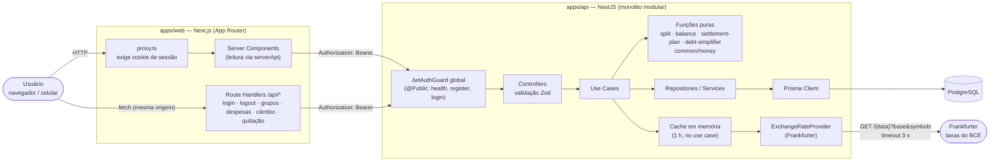
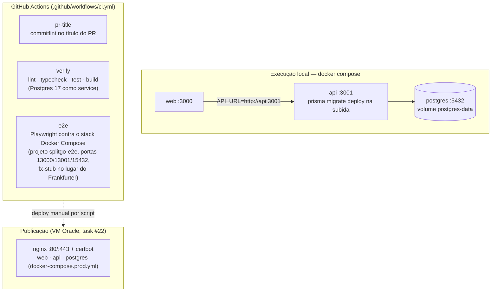
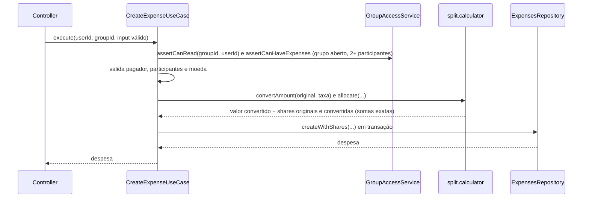

# Plano de Arquitetura

Este documento descreve **como** o Split&Go é construído. O **quê** está em `docs/specs/`. Princípios inegociáveis estão em `docs/constitution.md`.

## 1. Visão geral



Fluxo de autenticação: o navegador envia e-mail e senha ao Route Handler `POST /api/auth/login`, que chama `POST /auth/login` na API e grava o `accessToken` (JWT, 24 h) no cookie `sg_session` (`httpOnly`, `SameSite=Lax`, `Secure` em produção). O navegador nunca lê o token: Server Components e Route Handlers o leem do cookie e o repassam à API como `Authorization: Bearer`. Sem cookie, `proxy.ts` redireciona para `/login`; uma resposta `401` da API leva a `/session-expired`, página que confirma a rejeição (`GET /auth/me`) e só então apaga o cookie por `POST /api/auth/logout` (nenhum `GET` altera o cookie, então um link externo não desloga ninguém). Todos os Route Handlers de mutação passam por `guardMutation` (Origin igual ao `Host`, `Content-Type` JSON) e validam UUIDs com `guardUuids`; `X-Forwarded-Host` só é aceito com `WEB_TRUST_FORWARDED_HOST=1`. Mutações do navegador passam pelos Route Handlers (nunca falam direto com a API). O CORS da API (`CORS_ORIGIN`) existe, mas o fluxo da interface não depende dele. Ver [ADR 0003](decisions/0003-jwt-httpOnly-cookie.md).

### Infraestrutura e CI



Os testes e2e usam `apps/web/e2e/docker-compose.e2e.yml`, que troca o provedor de câmbio real por um stub local (`fx-stub`), de modo que nenhum teste depende da internet.

| Componente | Escolha | Por quê |
|---|---|---|
| Banco | PostgreSQL | Dados altamente relacionais (grupo → participantes → despesas → partes), transações ACID para fechamento e invariantes de saldo, tipos inteiros exatos. |
| API | NestJS (LTS) + TypeScript | Estrutura modular nativa que mapeia direto para o monolito modular por domínio; injeção de dependência; ecossistema maduro. |
| ORM | Prisma | Schema declarativo, migrations versionadas, client tipado. |
| Validação | Zod | Schemas viram tipos TypeScript; compartilhável entre API e web. |
| Front-end | Next.js (App Router) | SSR, route handlers para guardar o JWT em cookie `httpOnly`, mesmo ecossistema TypeScript. |
| Câmbio | Frankfurter (taxas do BCE), sem chave de API | Gratuito, estável, com taxa por data e todas as moedas do catálogo. É só **sugestão**: o usuário confirma ou edita a taxa. Atrás de `ExchangeRateProvider`, trocável. Ver ADR 0006. |
| Fila / cache | Sem fila; cache **em memória** só para taxas de câmbio | Cálculos são O(2ⁿ·n) com n ≤ 16 e rodam em milissegundos. Ver ADR 0005. |
| Local | Docker Compose | Um comando sobe banco, API e web. |
| CI | GitHub Actions | Lint, testes e build a cada PR. |

## 2. Estilo arquitetural

**Monolito modular, em camadas tradicionais, separado por domínio.** Sem DDD.

```
Controller  →  Use Case  →  Repository / Service
 (HTTP/Zod)    (orquestra)    (dados / integrações)
```

| Camada | Responsabilidade | Não faz |
|---|---|---|
| **Controller** | Rotas, autenticação (guard), parse e validação Zod, chamar um use case, formatar resposta. | Regra de negócio, acesso a banco. |
| **Use Case** | Um caso de uso = uma classe com `execute()`. Autorização por grupo, carregar dados, chamar calculators, persistir (em transação quando preciso). | Conhecer HTTP. |
| **Repository** | Consultas Prisma de um módulo. Retorna tipos do Prisma ou DTOs simples. | Regra de negócio. |
| **Service** | Lógica reutilizável entre use cases do mesmo módulo ou integração (ex.: `PasswordService`; o JWT é assinado com o `JwtService` do `@nestjs/jwt`). | — |
| **Calculator** | Função pura com a regra complexa. | Acessar banco, relógio, rede. |

### Módulos (por domínio)

```
apps/api/src/
├── main.ts
├── app.module.ts
├── common/                  # infraestrutura transversal
│   ├── zod/                 #   ZodValidationPipe, helpers
│   ├── errors/              #   AppError, filtro global, códigos de erro
│   ├── auth/                #   JwtAuthGuard, @CurrentUser()
│   └── money/               #   catálogo de moedas, convertAmount, allocateProportionally, parse de taxa, limites
├── config/                  # validação das variáveis de ambiente (Zod)
├── prisma/                  # PrismaModule / PrismaService
└── modules/
    ├── auth/                #   register, login, me (inclui UsersRepository)
    ├── health/              #   GET /health
    ├── groups/              #   grupos e participantes, autorização de acesso
    ├── currencies/          #   catálogo de moedas (GET /currencies)
    ├── exchange-rates/      #   sugestão de taxa (GET /exchange-rates) + ExchangeRateProvider
    ├── expenses/            #   CRUD de despesas + split.calculator
    ├── balances/            #   saldo, extrato + balance.calculator
    └── settlements/         #   plano, fechamento, transferências + debt-simplifier
```

Estrutura interna de um módulo (exemplo `expenses`):

```
modules/expenses/
├── expenses.module.ts
├── expenses.controller.ts
├── dto/                         # schemas Zod + tipos inferidos
│   └── expense.schemas.ts
├── create-expense.use-case.ts   # use cases na raiz do módulo (sem subpasta)
├── update-expense.use-case.ts
├── delete-expense.use-case.ts
├── get-expense.use-case.ts
├── list-expenses.use-case.ts
├── expenses.service.ts          # listForBalance, usado por balances e settlements
├── expenses.repository.ts
└── calculators/
    ├── split.calculator.ts
    └── split.calculator.spec.ts
```

**Regras de dependência entre módulos**

- `groups` é a fonte de verdade de acesso: expõe `GroupAccessService.assertCanRead / assertIsOwner`, usado por `expenses`, `balances` e `settlements`. Regras de escrita em despesas (grupo aberto, criador ou dono) ficam em `modules/expenses/expense-access.ts`.
- `balances` lê despesas por meio de `ExpensesService.listForBalance(groupId)`, nunca pelo repository de `expenses`.
- `settlements` usa `ExpensesService.listForBalance` + `calculateBalances` + `debt-simplifier`.
- Sem dependências circulares: `settlements → expenses → groups`; `balances → expenses → groups`.

### Interfaces: apenas quando necessárias

Classes concretas são injetadas diretamente pelo DI do Nest. Uma interface só entra se houver duas implementações reais ou uma fronteira externa que precise ser simulada em teste.

**Única interface do MVP: `ExchangeRateProvider`.** É uma fronteira externa (HTTP) que precisa ser trocada por uma implementação falsa nos testes e pode ter outro provedor no futuro. Implementações: `FrankfurterExchangeRateProvider` (real) e `FakeExchangeRateProvider` (testes, em `apps/api/test/support/`). O cache em memória (TTL de 1 h) fica em `GetExchangeRateUseCase`, não no provider. Decisão registrada nos ADRs 0004 e 0006.

## 3. Como tratamos regras complexas sem DDD

O desafio do domínio está em quatro regras: **conversão cambial**, **rateio com resto da menor unidade**, **saldo** e **simplificação de dívidas**. Abordagem avaliada e escolhida:

| Abordagem | Avaliação |
|---|---|
| Entidades ricas / agregados (DDD) | Descartada: proibida pela constituição e excessiva para o tamanho do domínio. |
| Lógica nos use cases | Descartada: mistura orquestração e regra, dificulta teste exaustivo. |
| **Funções puras (calculators)** | **Escolhida.** Entrada e saída são dados simples; sem banco, sem relógio; testáveis com milhares de casos e testes de propriedade. |

Fluxo típico (`CreateExpenseUseCase`):



### Calculators

| Função | Entrada | Saída |
|---|---|---|
| `convertAmount(originalMinor, rate, originCurrency, baseCurrency)` | valor, taxa (texto decimal) e moedas | valor convertido (`BigInt`, meio para cima) |
| `allocateProportionally(total, weights)` | total e pesos por participante | partes inteiras com soma exata (maior resto, desempate por `memberId`) |
| `calculateShares(input)` | valor original, valor convertido e regra (`EQUAL` / `PERCENTAGE` / `FIXED`) | `[{ memberId, originalAmountMinor, amountMinor }]`, somas exatas nas duas moedas |
| `calculateBalances(expenses)` | despesas com pagador e partes | `Map<memberId, netMinor>` com soma `0` |
| `buildStatement(memberId, expenses)` | despesas do grupo | linhas com saldo acumulado |
| `simplifyDebts(balances)` | saldos por participante | `[{ from, to, amountMinor }]` mínimo (exato até 16 saldos; `simplifyDebtsGreedy` acima disso) |
| `calculateSettlementPlan(...)` | saldos | plano de transferências na moeda-base |

### Algoritmo de simplificação (resumo; detalhes no ADR 0002)

1. Remover saldos `0`.
2. Se restam `≤ 16` saldos: **solução exata.** Encontrar a partição dos participantes no maior número `g` de subgrupos cuja soma é zero. Cada subgrupo de `k` pessoas é quitado com `k − 1` transferências, totalizando `n − g`. DP por bitmask em `O(2ⁿ · n)`.
3. Se restam mais de 16: **heurística gulosa**, maior credor × maior devedor, com no máximo `n − 1` transferências.
4. Desempates por `memberId` crescente → resultado determinístico.

## 4. Concorrência e integridade

- Criar, editar e excluir despesas e fechar o grupo rodam em **transação**.
- O fechamento faz `SELECT … FOR UPDATE` na linha do grupo (via `$queryRaw` dentro da transação); a criação de despesa faz o mesmo e confere `status = OPEN`. Isso serializa as duas operações e satisfaz `AC-BAL-14`.
- Constraints no banco (unicidade, FKs, `CHECK amount_minor > 0`) são a última linha de defesa; validações de aplicação dão as mensagens claras.

## 5. Autenticação e autorização

- `POST /auth/login` retorna um JWT (24h). O Next guarda o token no cookie `sg_session` (`httpOnly`, `SameSite=Lax`, `Secure` em produção, 24 h), e repassa à API no header `Authorization: Bearer`.
- `JwtAuthGuard` global (`APP_GUARD` em `auth.module.ts`); rotas públicas marcadas com `@Public()` (`/health`, `/auth/register`, `/auth/login`).
- Autorização por grupo no use case via `GroupAccessService` (dono vs. participante vinculado). Acesso sem vínculo → `404`.

## 6. Tratamento de erros

Um filtro global converte `AppError` (e erros do Zod/Prisma conhecidos) no contrato de `api-contract.md`: `{ statusCode, code, message, details? }`. Erros inesperados viram `500 INTERNAL_ERROR` com mensagem genérica; o detalhe vai apenas para o log.

## 7. Front-end

- Next.js (App Router) + TypeScript + Tailwind CSS.
- Server Components para leitura; Client Components para formulários interativos (prévia do rateio).
- Cliente de API tipado em `apps/web/src/lib/api`; schemas Zod compartilhados reaproveitados quando fizer sentido (pacote `packages/shared`, hoje vazio).
- Formatação monetária com `Intl.NumberFormat('pt-BR', { style: 'currency', currency })`, usando a moeda e as casas decimais do catálogo (`GET /currencies`) e dividindo a menor unidade apenas para exibição.
- O formulário de despesa busca a taxa sugerida em `GET /exchange-rates` (via Route Handler), permite editá-la e espelha em prévia a conversão e o rateio (mesmas regras de `allocateProportionally`).

### Design system (task #52)

Base visual do front-end, no estilo de apps de rateio (identidade verde, listas densas, avatar + valor à direita), com marca própria (Split&Go: ícone Lucide + texto). Detalhes de uso em [README](../../README.md#design-system).

- **Stack:** shadcn/ui (convenção de `components.json`, componentes copiados para `apps/web/src/components/ui/`), Radix (somente `@radix-ui/react-dialog`), `class-variance-authority`, `clsx` + `tailwind-merge` (`cn` em `lib/utils.ts`), `lucide-react` e `sonner` (toast).
- **Tokens:** `apps/web/src/app/globals.css`. Valores brutos em `:root` (cores semânticas: `background`, `foreground`, `card`, `muted`, `primary`, `link`, `destructive`, `positive` = "recebe", `negative` = "deve", `ring`...) mapeados por `@theme inline` para utilitários Tailwind. Fonte: pilha de sistema (sem CDN e sem requisição externa). Aliases legados (`brand-*`, `surface`, `ink`, `line`, `danger-*`) existem só até as telas serem migradas (#53 a #55).
- **Acessibilidade:** `lib/ui/contrast.spec.ts` lê os tokens de `globals.css` e falha se algum par cair abaixo de AA (4,5:1 texto; 3:1 componentes e foco). Foco visível global, `prefers-reduced-motion` respeitado, link "Pular para o conteúdo", `lang="pt-BR"`, safe-area no cabeçalho e no conteúdo.
- **Decisões:** `Select` continua `<select>` nativo estilizado (teclado e seletor móvel gratuitos); abas do grupo são links (`NavTabs`, server component, `?tab=` e `aria-current="page"`); tema escuro adiado (follow-up: sobrescrever os tokens de `:root` em `prefers-color-scheme: dark` e estender o teste de contraste).

## 8. Estrutura do repositório

```
.
├── apps/
│   ├── api/                 # NestJS + Prisma
│   └── web/                 # Next.js
├── packages/
│   └── shared/              # placeholder sem código (workspace declarado)
├── docs/                    # specs, arquitetura, engenharia, tasks, IA
├── scripts/board/           # automação do quadro de tarefas
├── .claude/                 # agentes e skills
├── .github/                 # templates e workflows
├── docker-compose.yml
├── package.json             # workspace pnpm
└── README.md
```

## 9. Observabilidade mínima

- **Não implementado:** logs estruturados (JSON) com `requestId`; hoje só o `Logger` padrão do Nest (erros 5xx).
- `GET /health` verifica API e conexão com o banco.
- Erros 5xx logados com stack; 4xx apenas com código.

## 10. Hospedagem (task #22)

Decisão do responsável: tudo em uma única VM (Oracle Cloud) com Docker Compose, em `https://splitandgo.duckdns.org`. Detalhes, deploy, rollback e backup em [`docs/engineering/deployment.md`](../engineering/deployment.md).

- **Stack:** `docker-compose.prod.yml` com `postgres` (volume persistente, sem porta publicada), `api`, `web` e `nginx` (único a publicar 80/443). TLS por Let's Encrypt (certbot, HTTP-01 webroot, renovação automática).
- **Migrations:** `prisma migrate deploy` na subida da API, antes de aceitar tráfego.
- **Segredos:** `.env` gerado no servidor, fora do repositório (modelo em `.env.production.example`).
- Variáveis: `DATABASE_URL`, `JWT_SECRET`, `API_URL` (web → API, rede interna), `CORS_ORIGIN` (`https://$DOMAIN`), `FX_PROVIDER_URL` (padrão `https://api.frankfurter.dev/v1`), `WEB_TRUST_FORWARDED_HOST=1`.
